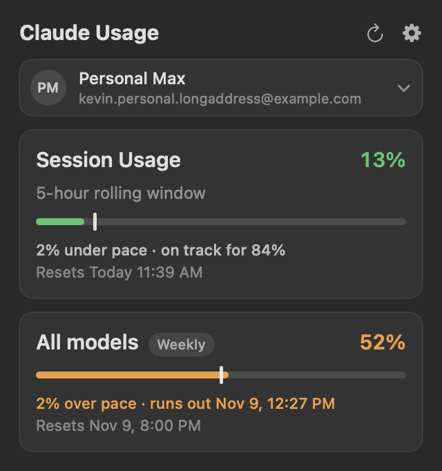
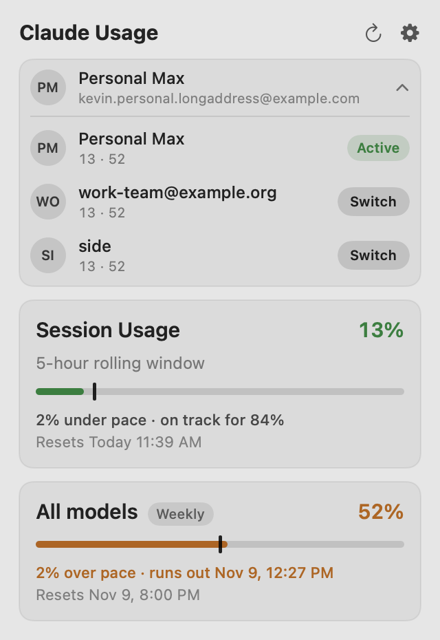

<div align="center">


# Claude Profiles for Mac

**Every Claude Code account's usage in your Mac's menu bar, and one-click switching between them.**

[](https://github.com/kevinabouhanna/claude-profiles-mac/releases/latest)
[](https://github.com/kevinabouhanna/claude-profiles-mac/actions/workflows/ci.yml)


**[⬇️ Download for Mac](https://github.com/kevinabouhanna/claude-profiles-mac/releases/latest/download/ClaudeProfiles.dmg)** · [All releases](https://github.com/kevinabouhanna/claude-profiles-mac/releases) · [Windows version](https://github.com/kevinabouhanna/claude-profiles-windows)



<br><sub>Demo data.</sub>

</div>

---

The Mac counterpart of [Claude Profiles for Windows](https://github.com/kevinabouhanna/claude-profiles-windows).
It sits in the menu bar as two numbers, your 5-hour session usage and your weekly usage, and opens
into a Liquid Glass dropdown with the detail. It's built on
[claude-swap](https://github.com/realiti4/claude-swap), which keeps your logins; this app never
reads or stores a credential itself.

## Features

| | |
|---|---|
| 📊 **Usage at a glance** | Session and weekly percentages in the menu bar, with any per-model weekly limits in the dropdown. |
| 📏 **Know your pace** | A marker on each bar shows where even usage would put you, and a forecast says whether you'll run out before the reset. |
| 🔁 **One-click switching** | Open the account list in the dropdown and click Switch. |
| 🏷️ **Name your accounts** | Call them Work, Personal or anything else, spaces included, instead of reading email addresses. |
| 🤖 **Auto-Switch** | Optionally moves to another account when the active one nears its limit (`cswap auto`). |
| 🎨 **Your menu bar, your style** | Layout, separator, labels, size and weight, and colors that follow the menu bar, follow your usage, or are custom, with separate light and dark picks. |
| 🌗 **Light and dark** | Everything follows the system appearance, the menu bar's own included. |
| 🔒 **Local only** | No telemetry. The only network traffic is claude-swap's own usage checks. |

## Install

1. Install claude-swap: `uv tool install claude-swap` (or `pipx install claude-swap`), and add your accounts with `cswap add`.
2. [Download the disk image](https://github.com/kevinabouhanna/claude-profiles-mac/releases/latest/download/ClaudeProfiles.dmg), open it, and drag **Claude Profiles** to Applications.

The app is signed with a Developer ID and notarized by Apple, so it opens without a warning.
It needs macOS 26 or later, on Apple silicon or Intel.

## Using it

- **Left-click** the numbers for the dropdown. Click the active account to see the others and switch.
- **Right-click** for Settings and Quit.
- **Rename an account:** Settings → Accounts → ••• → Rename…
- The dropdown closes when you click anywhere else, including another menu bar item, press Esc, or switch apps.

## Building from source

Needs the Xcode command line tools (Swift 6) on macOS 26 or later.

```sh
./build.sh             # build/Claude Profiles.app, ad-hoc signed
./build.sh --install   # and copy it to /Applications and launch it
```

`./build.sh --release` signs with a Developer ID, notarizes, staples and builds a disk image; see the
top of `build.sh` for what it needs. Releases are cut by pushing a `v*` tag, which runs
`.github/workflows/release.yml`. It needs these repository secrets:

| Secret | What it is |
|---|---|
| `DEVID_P12_BASE64` | The Developer ID Application certificate and key, exported as .p12, base64-encoded |
| `DEVID_P12_PASSWORD` | That .p12's password |
| `NOTARY_KEY_BASE64` | An App Store Connect API key (.p8), base64-encoded |
| `NOTARY_KEY_ID` | That key's ID |
| `NOTARY_ISSUER` | Its issuer ID |

## License

[MIT](LICENSE)
