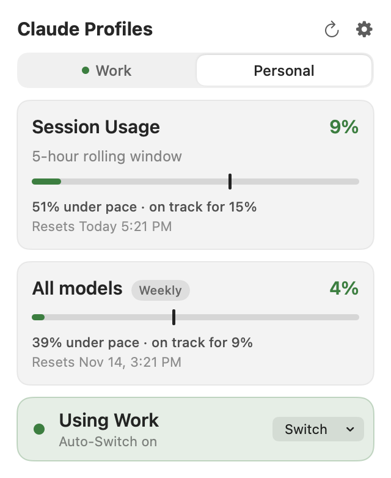

<div align="center">


# Claude Profiles for Mac

**Every Claude Code account's usage in your Mac's menu bar, and one-click switching between them.**

[](https://github.com/kevinabouhanna/claude-profiles-mac/releases/latest)
[](https://github.com/kevinabouhanna/claude-profiles-mac/actions/workflows/ci.yml)


**[⬇️ Download for Mac](https://github.com/kevinabouhanna/claude-profiles-mac/releases/latest/download/ClaudeProfiles.dmg)** · [All releases](https://github.com/kevinabouhanna/claude-profiles-mac/releases) · [Windows version](https://github.com/kevinabouhanna/claude-profiles-windows)



<br><sub>Demo data.</sub>

</div>

---

Claude Profiles sits in the menu bar as two numbers, your 5-hour session usage and your weekly
usage, and opens into a Liquid Glass dropdown with the detail.

## Features

| | |
|---|---|
| 📊 **Usage at a glance** | Session and weekly percentages in the menu bar, with pace and reset times in the dropdown for any account, not only the one in use. Per-model limits (Fable's is hidden by default) can be shown in Settings → General. |
| 📏 **Know your pace** | A marker on each bar shows where even usage would put you, and a forecast says whether you'll run out before the reset. |
| 🔁 **Quick switching** | The status bar at the bottom of the dropdown always says which account Claude Code is using; its Switch menu lists every account with its numbers. |
| 🏷️ **Name your accounts** | Call them Work, Personal or anything else, spaces included, instead of reading email addresses. |
| 🤖 **Auto-Switch** | Optionally moves to another account when the active one nears its limit (`cswap auto`). |
| 🎨 **Your menu bar, your style** | Layout, separator, labels, size and weight, and colors that follow the menu bar, follow your usage, or are custom, with separate light and dark picks. |
| 🌗 **Light and dark** | Everything follows the system appearance, the menu bar's own included. |
| 🔒 **Local only** | No telemetry. The only network traffic is claude-swap's own usage checks. |

## Install

1. Install claude-swap: `uv tool install claude-swap` (or `pipx install claude-swap`), and add your accounts with `cswap add`.
2. [Download the disk image](https://github.com/kevinabouhanna/claude-profiles-mac/releases/latest/download/ClaudeProfiles.dmg), open it, and drag **Claude Profiles** to Applications.

The app is signed with a Developer ID and notarized by Apple, so it opens without a warning.
It needs macOS 26 or later, on Apple silicon or Intel.

## Using it

- **Left-click** the numbers for the dropdown. Click an account's tab to see its usage and pace without switching; a green dot marks the one in use. With more than three accounts, the arrow after the tabs lists them all. To switch, use the Switch menu in the status bar at the bottom.
- **Right-click** for Settings and Quit.
- **Rename an account:** Settings → Accounts → ••• → Rename…
- The dropdown closes when you click anywhere else, including another menu bar item, press Esc, or switch apps.

## Building from source

Needs the Xcode command line tools (Swift 6) on macOS 26 or later.

```sh
./build.sh             # build/Claude Profiles.app, ad-hoc signed
./build.sh --install   # and copy it to /Applications and launch it
```

Before sending a change, run the energy test: it launches its own copy of the app, safely
alongside one you have open, and fails on excess CPU, memory growth or leftover processes.
CI and the release workflow run it too, and a release can't be cut if it fails.

```sh
./scripts/energy-test.sh
```

The README's pictures are drawn by the app from made-up accounts (`shots/demo.json`), never
captured from the screen. After changing the dropdown, `shots-kit check` (from the
[product-kit](https://github.com/kevinabouhanna/product-kit) Claude Code plugin) says whether
they changed, and `shots-kit update` redraws them.

`./build.sh --release` signs with a Developer ID, notarizes, staples and builds a disk image; see the
top of `build.sh` for what it needs. Releases are cut by pushing a `v*` tag, which runs
`.github/workflows/release.yml`. It needs these repository secrets:

| Secret | What it is |
|---|---|
| `DEVID_P12_BASE64` | The Developer ID Application certificate and key, exported as .p12, base64-encoded |
| `DEVID_P12_PASSWORD` | That .p12's password |
| `NOTARY_KEY_BASE64` | An App Store Connect API key (.p8), base64-encoded |
| `NOTARY_KEY_ID` | That key's ID |
| `NOTARY_ISSUER` | Its issuer ID |

## Open Source Dependencies

- **[claude-swap](https://github.com/realiti4/claude-swap)** (`cswap`) does the account work. The app
  runs it to list your accounts and their usage (`cswap list`), switch accounts (`cswap switch`), save
  logins and include or exclude them from Auto-Switch (`cswap add`, `enable`, `disable`), read and change
  Auto-Switch settings (`cswap config`), and run Auto-Switch itself (`cswap auto`). claude-swap keeps
  your logins; this app never reads or stores a credential itself. Install it separately (see
  [Install](#install)); it isn't bundled.

Everything else is Apple's own frameworks (AppKit, SwiftUI, Combine), with no third-party packages.

## License

[MIT](LICENSE)
